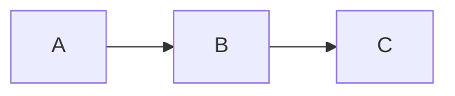

# vim-mermaid

A Vim plugin that shows ```` ```mermaid ```` blocks of Markdown as ASCII art in a split window.
It uses [mermaid-ascii](https://github.com/AlexanderGrooff/mermaid-ascii) to draw the diagrams.

Example: run `:MermaidPreview` inside this block.

````markdown

````

The split window on the right shows this diagram.

```
┌───┐     ┌───┐     ┌───┐
│   │     │   │     │   │
│ A ├────►│ B ├────►│ C │
│   │     │   │     │   │
└───┘     └───┘     └───┘
```

## Requirements

- Vim 9.1 or later, with `+job` and `+timers`. Neovim is not supported.
- The `mermaid-ascii` command. Install it with:

```sh
go install github.com/AlexanderGrooff/mermaid-ascii@latest
```

In our checks, mermaid-ascii could draw these three diagram types:

- `graph` and `flowchart` (directions TD, TB, BT, LR, RL)
- `sequenceDiagram`
- `erDiagram`

It cannot draw `classDiagram`, `stateDiagram-v2`, or `pie`. For these, the split window shows the error text from mermaid-ascii.

## Installation

With vim-plug, add this line to your `~/.vimrc`:

```vim
Plug 'hatajoe/vim-mermaid'
```

## Usage

| Command | Action |
|---|---|
| `:MermaidPreview` | Draw the mermaid block under the cursor |
| `:MermaidPreviewAll` | Draw every mermaid block in the buffer. Each block gets a `-- line N --` header |
| `:MermaidClose` | Close the split window |

There are no default key mappings. To add one, write for example:

```vim
autocmd FileType markdown nmap <buffer> <Leader>mp <Plug>(mermaid-preview)
```

## Options

| Variable | Default | Meaning |
|---|---|---|
| `g:mermaid_ascii_cmd` | `'mermaid-ascii'` | Path of the render command |
| `g:mermaid_ascii_args` | `[]` | Extra arguments for the render command (for example, `['-a']` draws with ASCII characters only) |
| `g:mermaid_split` | `'vertical'` | Split direction. `'horizontal'` splits top and bottom |
| `g:mermaid_auto_refresh` | `0` | When `1`, each save draws the shown diagram again |
| `g:mermaid_timeout_ms` | `5000` | Time in milliseconds before the render is stopped |

See `:help mermaid` for details.

## Tests

```sh
test/run.sh
```

If `mermaid-ascii` is not on your PATH, only the tests that use the real command are skipped.

## License

MIT. See [LICENSE](LICENSE).
