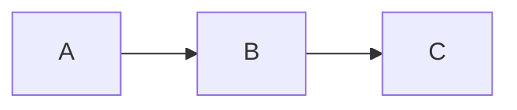

# vim-mermaid

A Vim plugin that shows ```` ```mermaid ```` blocks of Markdown as ASCII art in a popup window or a split window.
It uses [mermaid-ascii](https://github.com/AlexanderGrooff/mermaid-ascii) to draw the diagrams.

Example: run `:MermaidPreview` inside this block.

````markdown

````

A popup window below the cursor shows this diagram. Move the cursor or press `<Esc>` to close it.

```
┌───┐     ┌───┐     ┌───┐
│   │     │   │     │   │
│ A ├────►│ B ├────►│ C │
│   │     │   │     │   │
└───┘     └───┘     └───┘
```

## Requirements

- Vim 9.1 or later, with `+job` and `+timers`. Neovim is not supported.
- Popup mode (the default) also needs `+popupwin`. Split mode does not.
- The `mermaid-ascii` command. Install it with:

```sh
go install github.com/AlexanderGrooff/mermaid-ascii@latest
```

In our checks, mermaid-ascii could draw these three diagram types:

- `graph` and `flowchart` (directions TD, TB, BT, LR, RL)
- `sequenceDiagram`
- `erDiagram`

It cannot draw `classDiagram`, `stateDiagram-v2`, or `pie`. For these, the popup or split window shows the error text from mermaid-ascii.

## Installation

With vim-plug, add this line to your `~/.vimrc`:

```vim
Plug 'hatajoe/vim-mermaid'
```

## Usage

| Command | Action |
|---|---|
| `:MermaidPreview` | Draw the mermaid block under the cursor |
| `:MermaidPreviewAll` | Draw every mermaid block in the buffer. Each block gets a `-- line N --` header |
| `:MermaidClose` | Close the popup window and the split window of the current tab |

## Popup and split

By default the diagram opens in a popup window below the cursor.
The popup closes when the cursor moves, when you press `<Esc>` in Normal mode, or with `:MermaidClose`.
If the cursor moves or the text changes before the render is done, no popup opens.

### Scrolling the popup

A diagram taller than the popup gets a scrollbar.
While the popup is open, these keys in Normal mode scroll it:

| Key | Action |
|---|---|
| `<C-j>` | One line down |
| `<C-k>` | One line up |
| `<C-d>` | Half a page down |
| `<C-u>` | Half a page up |

The popup stays open.
At the top or the bottom, the keys do nothing.
When the whole diagram fits, the keys also do nothing, but they do not reach Vim.
When no popup is open, the keys work as usual.

The mouse wheel also scrolls the popup.
This needs `:set mouse=a` and a terminal that sends mouse events to Vim.

To use a split window instead, set:

```vim
let g:mermaid_display = 'split'
```

There are no default key mappings. To add one, write for example:

```vim
autocmd FileType markdown nmap <buffer> <Leader>mp <Plug>(mermaid-preview)
```

## Options

| Variable | Default | Meaning |
|---|---|---|
| `g:mermaid_ascii_cmd` | `'mermaid-ascii'` | Path of the render command |
| `g:mermaid_ascii_args` | `[]` | Extra arguments for the render command (for example, `['-a']` draws with ASCII characters only) |
| `g:mermaid_display` | `'popup'` | Where the diagram is shown: `'popup'` or `'split'` |
| `g:mermaid_popup_maxheight` | `&lines - 4` | Maximum height of the popup. Longer diagrams get a scrollbar |
| `g:mermaid_popup_maxwidth` | `&columns - 4` | Maximum width of the popup |
| `g:mermaid_split` | `'vertical'` | Split direction in split mode. `'horizontal'` splits top and bottom |
| `g:mermaid_auto_refresh` | `0` | Split mode only. When `1`, each save draws the shown diagram again |
| `g:mermaid_timeout_ms` | `5000` | Time in milliseconds before the render is stopped |

See `:help mermaid` for details.

## Tests

```sh
test/run.sh
```

If `mermaid-ascii` is not on your PATH, only the tests that use the real command are skipped.
The `Test_term_*` tests run a second Vim in a terminal window to send real keys. They are skipped without `+terminal`.

## License

MIT. See [LICENSE](LICENSE).
